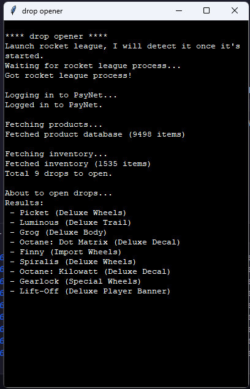

# drop opener

Open all your drops at once with the click of a button! Only works on Epic (or alt Epic launchers).

## Installation

Currently you need to have python installed (recommended to use uv). Clone the repo and run the drop-opener module and then a window will pop up which will give you instructions.

Native exes soon

## Contributing

Contributions are welcome in all shapes and forms.

## How it works

When you launch rocket league, epic passes an authentication token to it to log in. But this reads the authentication token from the rocket league arguments and then exits the game before it starts, so the token doesn't get used. Then we can use the authentication token to log in to rocket league ourselves and use the game's api to open all the drops at once.

## Development

- The main ui handler and program runner is in `__init__.py`
- `products.py` has stuff to download/parse the product database from github
- `rlapi.py` contains logging to psynet and the websocket api
