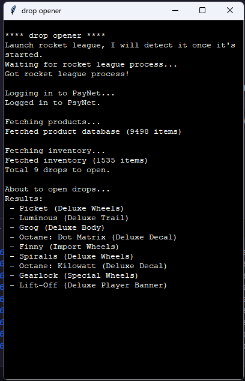

# drop opener

Open all your drops at once with the click of a button! Only works on Epic (or alt Epic launchers).

## Installation

To download, go to the releases section ([https://github.com/kalilamodow/drop-opener/releases/latest](https://github.com/kalilamodow/drop-opener/releases/latest)), then follow the instructions there.

Once you open the program, it'll give you instructions on what to do.

Important: it doesn't work if rocket league is already running. Make sure to open rocket league _after_ you open drop-opener.

## How it works

When you launch rocket league, epic passes an authentication token to it to log in. But this reads the authentication token from the rocket league arguments and then exits the game before it starts, so the token doesn't get used. Then we can use the authentication token to log in to rocket league ourselves and use the game's api to open all the drops at once.

## Contributing

Contributions are welcome in all shapes and forms.

## Development

- The main ui handler and program runner is in `__init__.py`
- `products.py` has stuff to download/parse the product database from github
- `rlapi.py` contains logging to psynet and the websocket api

You can run `uv run pyinstaller --onefile src/main.py` to build an executable.
